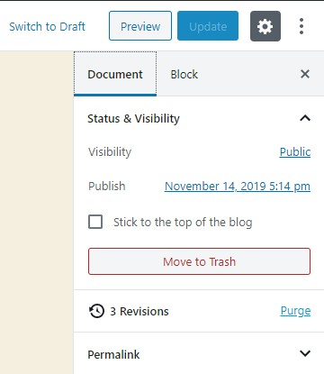
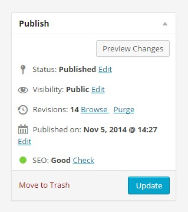

# Simple Revisions Delete

**Delete the revisions of a post one by one or all at once, from the block editor, the classic editor or a bulk action.**


WordPress keeps every revision of every post, forever, unless you tell it otherwise. Most cleanup plugins answer that with one big button that wipes the revisions of the whole site. This one works post by post: you purge the revisions of the post you're editing, and only those.

There is no settings page and nothing to configure. Revisions are deleted with the core function `wp_delete_post_revision()`, so the post itself and its current content are never touched.

Install it from wordpress.org: **[wordpress.org/plugins/simple-revisions-delete](https://wordpress.org/plugins/simple-revisions-delete/)**. This repository is a copy of the plugin's history, for reading the code. Releases are still published on wordpress.org.

## Where you find it

- **Block editor**: a "Purge" button in the post status panel of the sidebar, with the number of revisions.
- **Classic editor**: the same control in the Publish box, and a "Delete" button next to each revision in the Revisions box.
- **Posts and pages lists**: a "Purge revisions" bulk action.

<p>
  
  
</p>

Nothing reloads the page. The block editor goes through the REST API, the classic editor through admin-ajax. Without JavaScript, the classic editor control falls back to a normal form and the bulk action still works.

## Filters

Posts and pages are supported by default. Add your own post types with `wpsrd_post_types_list`:

```php
add_filter( 'wpsrd_post_types_list', function ( $post_types ) {
	$post_types[] = 'my-cpt';
	return $post_types;
} );
```

Deleting revisions requires the `delete_post` capability on the post. Change it with `wpsrd_capability`:

```php
add_filter( 'wpsrd_capability', function () {
	return 'edit_post';
} );
```

## REST API

Three routes under `wpsrd/v1`, each checking the post type and the capability above:

- `GET /wpsrd/v1/posts/<id>/revisions` returns the number of revisions.
- `DELETE /wpsrd/v1/posts/<id>/revisions` deletes all of them.
- `DELETE /wpsrd/v1/posts/<id>/revisions/<revision_id>` deletes one.

## Requirements

WordPress 6.4 and PHP 7.4 or newer. Tested up to WordPress 6.9. Translated into French, German and Dutch.

## History

The full history comes from the plugin's SVN repository on wordpress.org, from the first release in January 2015 to today. Each version published on wordpress.org has its own tag. Version 2.0 (September 2026) is a rewrite: the block editor part is now a real editor plugin built on its own REST routes, instead of jQuery reading Gutenberg's markup, which broke when Gutenberg 7.1 changed it. The banner, icon and screenshots of the plugin page are in `.wordpress-org/`.

The French version of this file is `README_FR.md`.

## License

GPLv2 or later, see `LICENSE`.
