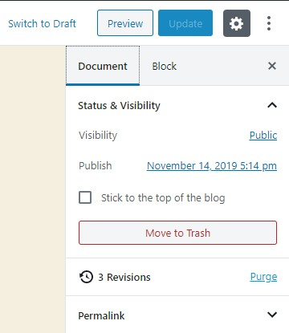
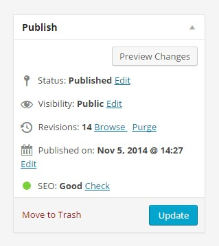

# Simple Revisions Delete

**Supprime les révisions d'un article une par une ou toutes d'un coup, depuis l'éditeur de blocs, l'éditeur classique ou une action groupée.**


WordPress garde chaque révision de chaque article, pour toujours, sauf si on lui dit le contraire. La plupart des plugins de nettoyage répondent avec un gros bouton qui efface les révisions de tout le site. Celui-ci travaille article par article : vous purgez les révisions de l'article que vous modifiez, et seulement celles-là.

Pas de page de réglages, rien à configurer. Les révisions sont supprimées avec la fonction du cœur `wp_delete_post_revision()` : l'article lui-même et son contenu actuel ne sont jamais touchés.

Pour l'installer, passez par wordpress.org : **[wordpress.org/plugins/simple-revisions-delete](https://fr.wordpress.org/plugins/simple-revisions-delete/)**. Ce dépôt est une copie de l'historique du plugin, pour lire le code. Les versions restent publiées sur wordpress.org.

## Où le trouver

- **Éditeur de blocs** : un bouton « Purger » dans le panneau d'état de la barre latérale, avec le nombre de révisions.
- **Éditeur classique** : le même contrôle dans la boîte Publier, et un bouton « Supprimer » à côté de chaque révision dans la boîte Révisions.
- **Listes des articles et des pages** : une action groupée « Purger les révisions ».

<p>
  
  
</p>

Rien ne recharge la page. L'éditeur de blocs passe par l'API REST, l'éditeur classique par admin-ajax. Sans JavaScript, le contrôle de l'éditeur classique repasse par un formulaire normal et l'action groupée fonctionne toujours.

## Filtres

Les articles et les pages sont pris en charge par défaut. Ajoutez vos propres types de contenu avec `wpsrd_post_types_list` :

```php
add_filter( 'wpsrd_post_types_list', function ( $post_types ) {
	$post_types[] = 'my-cpt';
	return $post_types;
} );
```

Supprimer des révisions demande la capacité `delete_post` sur l'article. Changez-la avec `wpsrd_capability` :

```php
add_filter( 'wpsrd_capability', function () {
	return 'edit_post';
} );
```

## API REST

Trois routes sous `wpsrd/v1`, qui vérifient toutes le type de contenu et la capacité ci-dessus :

- `GET /wpsrd/v1/posts/<id>/revisions` renvoie le nombre de révisions.
- `DELETE /wpsrd/v1/posts/<id>/revisions` les supprime toutes.
- `DELETE /wpsrd/v1/posts/<id>/revisions/<revision_id>` en supprime une.

## Prérequis

WordPress 6.4 et PHP 7.4 ou plus récents. Testé jusqu'à WordPress 6.9. Traduit en français, allemand et néerlandais.

## Historique

L'historique complet vient du dépôt SVN du plugin sur wordpress.org, de la première version en janvier 2015 jusqu'à aujourd'hui. Chaque version publiée sur wordpress.org a son tag. La version 2.0 (septembre 2026) est une réécriture : la partie éditeur de blocs est désormais un vrai plugin d'éditeur appuyé sur ses propres routes REST, au lieu de jQuery qui lisait le balisage de Gutenberg et a cassé quand Gutenberg 7.1 l'a modifié. La bannière, l'icône et les captures de la page du plugin sont dans `.wordpress-org/`.

La version anglaise de ce fichier est `README.md`.

## Licence

GPLv2 ou ultérieure, voir `LICENSE`.
